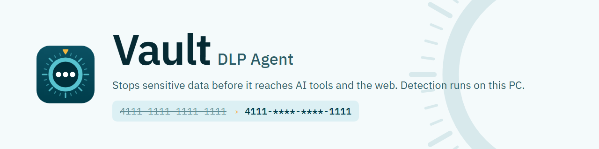

<picture>
  <source media="(prefers-color-scheme: dark)" srcset="assets/readme-agent-dark.png">
  
</picture>

# Vault DLP Agent for Windows

The Vault DLP Agent protects an organisation's data on Windows PCs. It checks what people upload or post
from browsers and apps (AI chat sites, forms, file uploads) for sensitive information such as card
numbers, ID numbers, passwords and keys, and personal details, and warns or blocks according to
the organisation's policies.

- **Everything is checked on the PC.** Files and messages are never sent anywhere for scanning.
  Only masked findings (`4532-****-****-0366`) reach the organisation's admin server.
- **Works without a server.** Out of the box it blocks private keys, card numbers and secrets,
  and warns on ID numbers and bank details. Connected to an admin server (the
  [Vault Server](https://github.com/kudzaiprichard/vault-dlp-server-release)) it follows the
  organisation's policies and reports incidents to its dashboard.
- **Keeps working offline.** With no connection it keeps the last policies and queues its reports
  until the server is back.

This repository holds the **downloads and user documentation** only.

| Guide                                              | For                                                                                         |
| -------------------------------------------------- | ------------------------------------------------------------------------------------------- |
| This page                                          | Everyone: download, install, connect, upgrade, uninstall                                    |
| [docs/deploying.md](docs/deploying.md)             | IT administrators: silent installs, installer options, settings files, PCs without internet |
| [docs/settings.md](docs/settings.md)               | IT administrators: every setting in the agent's settings file                               |
| [docs/troubleshooting.md](docs/troubleshooting.md) | Everyone: when something doesn't work                                                       |
| [CHANGELOG.md](CHANGELOG.md)                       | What changed in each version                                                                |

## Requirements

- Windows 10 or 11, 64-bit (the WebView2 runtime, built into Windows 11, is installed if missing).
- About 1.5 GB of free memory and 700 MB of disk once the detection model is installed.
- Internet access on first start to download the detection model (about 630 MB), or the model
  files copied from another PC ([PCs without internet](docs/deploying.md#pcs-without-internet)).

## Download

Open the [latest release](https://github.com/kudzaiprichard/vault-dlp-agent-release/releases/latest)
and download:

| File                                       | What it is                                  |
| ------------------------------------------ | ------------------------------------------- |
| `DLP-Agent_<version>_x64-setup.exe`        | The installer                               |
| `DLP-Agent_<version>_x64-setup.exe.sha256` | Its SHA-256 checksum                        |
| `agent-settings.example.toml`              | Example settings file for IT administrators |

**If your IT team gave you a zip or a folder** (for example from the admin server's
**Devices → Download agent** page), use that instead: it already contains the installer and your
organisation's settings.

### Check the download

In PowerShell, in the folder you downloaded to:

```powershell
(Get-FileHash .\DLP-Agent_0.2.1_x64-setup.exe -Algorithm SHA256).Hash
Get-Content .\DLP-Agent_0.2.1_x64-setup.exe.sha256
```

The two values must be the same (letter case doesn't matter). If they differ, don't run the file:
download it again.

## Install

1. **Double-click the setup file.** If your IT team gave you a folder or zip, extract it first and
   run the setup inside it: the settings next to it are picked up automatically.
2. If Windows says **"Windows protected your PC"**, click **More info**, then **Run anyway**. The
   installer isn't code-signed yet.
3. Setup explains that Windows will ask about a certificate called **DLP Agent Local Root CA**.
   **Click Yes.** The agent needs it to check secure (HTTPS) uploads. The certificate is created on
   your PC and never leaves it.
4. The agent starts in the system tray (the Vault icon next to the clock: a dial on a dark teal tile) and starts with Windows
   from then on.

It installs for the current Windows user only, and needs no administrator rights.

On first start it downloads its detection model in the background. Until that's done the status is
**Degraded**: protection is on, using rules only.

## Connect to your organisation's server

If the setup folder from your IT team included the server settings, it is already connected.
Otherwise click the tray icon to open the agent and, on the **Status** page, click **Connect** (or go
to **Settings → Server connection**):

1. **Server address:** the address your IT team gave you, starting with `https://`. If the server is
   installed on this same PC, click **This PC**.
2. **Registration key:** paste it if you were given one. Without one the PC joins and waits until an
   administrator assigns it ("Waiting for administrator").
3. **Server certificate:** leave **Find automatically**, unless you were given a certificate file
   (`root.crt`): then choose **Certificate file** and browse to it.
4. Click **Test connection**, then **Save and connect**.

The PC then appears on the admin server's dashboard under **Devices**.

## Check that it works

- The tray icon's tooltip says **DLP Agent: Inspecting traffic**. An amber badge on the icon means
  it is protecting with rules only for now (the detection model is still downloading); grey means
  paused, and red means protection couldn't start or was turned off by your administrator.
- The **Status** page says **Traffic inspection is on**, and the admin server card shows
  **Connected** (when a server is set up).

### What you'll see

| You see                            | Meaning                                                                                                                                                                                                                               |
| ---------------------------------- | ------------------------------------------------------------------------------------------------------------------------------------------------------------------------------------------------------------------------------------- |
| **Upload blocked** pop-up          | What you tried to send contains data your organisation doesn't allow to leave this way, such as a card number pasted into a chatbot. Nothing was sent. Remove the sensitive part, or contact your IT team if you think it's a mistake |
| **Sensitive data detected** pop-up | It was sent, but contained data to be careful with (for example an ID number). Check the recipient may have it                                                                                                                        |
| **Sensitive data was sent** pop-up | A large upload was let through so you weren't kept waiting, and the check found something afterwards. Your administrator is informed                                                                                                  |

The **Activity** page lists recent findings, always masked: the agent never stores or sends the
real values.

## Upgrade

Run the newer installer the same way. Settings, the PC's identity on the dashboard, policies and
anything waiting to be sent are kept, and the agent restarts on its own. Administrators can upgrade
many PCs at once: see [docs/deploying.md](docs/deploying.md#upgrades).

## Uninstall

**Settings → Apps → Installed apps → DLP Agent → Uninstall**. The uninstaller:

- stops the agent and restores your previous proxy setting;
- removes the **DLP Agent Local Root CA** certificate (Windows asks to confirm: **click Yes**);
- removes the program and its start-with-Windows entry;
- asks whether to delete the agent's data too (detection model, local database, logs, settings).
  Keep it if you'll reinstall: the PC then picks up where it left off.

The PC stays listed on the dashboard until an administrator removes it.

## Help

See [docs/troubleshooting.md](docs/troubleshooting.md), or contact your IT team. Logs are in
`%LOCALAPPDATA%\com.dlp.agent\logs` and the install log is `%LOCALAPPDATA%\DLP Agent\setup.log`; both
show only masked values.

## Related

- [Vault Server releases](https://github.com/kudzaiprichard/vault-dlp-server-release): the admin
  server and dashboard the agent reports to.

---

Released under the [MIT License](LICENSE). The installer also contains third-party components
(ONNX Runtime, PDFium, Tesseract language data) under their own licences, installed in the
`licenses` folder next to the agent.
